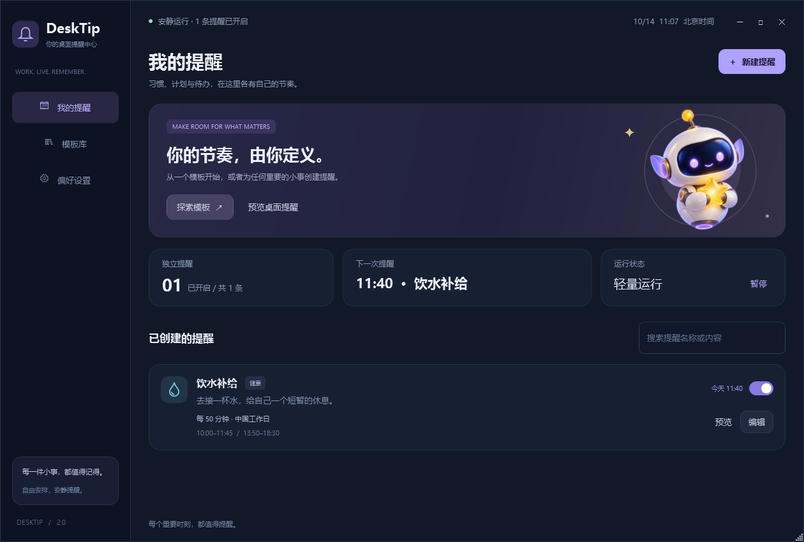
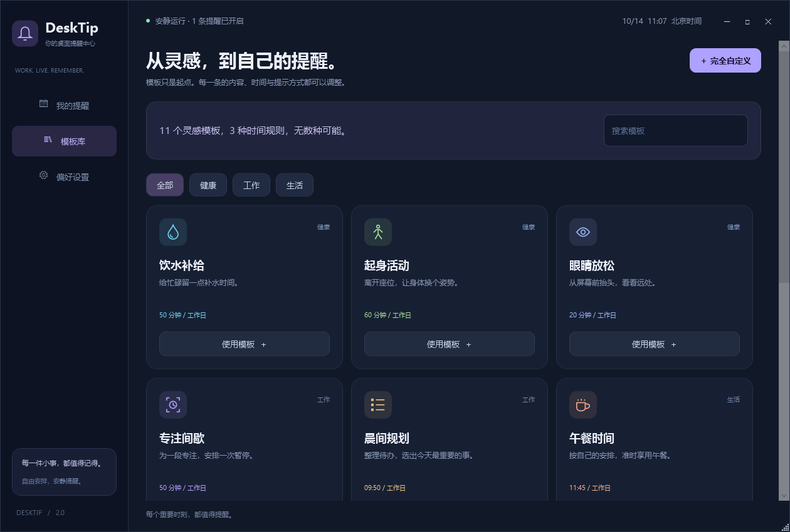

# DeskTip · 桌面提醒中心

原生 Windows 通用提醒应用。喝水是一个模板；工作、生活、习惯与一次性待办都可以拥有独立的内容、时间规则和提示方式。

[下载 Windows 版本](https://github.com/KSuperLiu/DeskTip/releases/latest)





## 开始使用

1. 下载通用便携版，解压整个文件夹，运行 `DeskTip.exe`。Windows 10 / 11 x64 无需额外安装 .NET。
2. 打开「模板库」选择模板，或点击「新建提醒」完全自定义。
3. 编辑内容、时间规则和提示方式，点击「保存提醒」。使用模板不会立即创建或开启提醒，保存后才生效。
4. 每条提醒都有独立开关，可以编辑、预览、删除。允许没有提醒或全部停用。
5. 关闭主窗口或按 Esc 收起到托盘，双击托盘图标重新打开。托盘菜单「退出」完全退出。

轻量版需要 .NET 8 Desktop Runtime x64。所有版本都需要保留整个解压目录，不能仅拷贝 EXE。

## 模板只是起点

内置 11 个模板：饮水补给、起身活动、眼睛放松、专注间歇、晨间规划、午餐时间、工作收尾、阅读学习、运动时间、文件备份、一次性待办。

可按健康、工作、生活分类筛选，搜索模板名称或分类。模板创建的是独立副本，可自由更改名称、内容、分类、图标、时间、工作日历、稍后分钟数和提示方式。可以从同一个模板创建多条不同规则。

首次运行仅启用饮水模板，沿用最初的工作安排：北京时间、中国工作日，上午 **10:00–11:45**，下午 **13:50–18:30**，每隔 **50 分钟**。

默认一天的时刻为 `10:50、11:40、14:40、15:30、16:20、17:10、18:00`。其他模板需自己选择并保存，不会自动全部开启。

## 独立时间规则

| 方式 | 适合的事情 | 配置 |
| --- | --- | --- |
| 按间隔重复 | 喝水、活动、专注间歇 | 1–480 分钟；1–12 个生效时段，每段独立计算首次提醒 |
| 固定时刻重复 | 规划、午餐、阅读、每周备份 | 1–24 个 HH:mm 时刻；支持多个时刻 |
| 指定日期一次 | 会议、取件、临时待办 | yyyy-MM-dd HH:mm，按指定日期提醒一次 |

重复提醒可以选择中国工作日、周一至周五、每天或自选星期。固定时刻不受间隔提醒的时段限制。一次性提醒按指定日期触发，不受工作日历限制。

每条规则独立计时，编辑其他提醒会保留本条提醒的稍后状态。日历变更会重新计算中国工作日规则，保留每天、自选星期和一次性规则的状态。

间隔提醒的时段结束时间不触发提醒；间隔大于时段长度时，该时段没有提醒。结束时间支持 `24:00`，可配置 `00:00–24:00` 全天时段；跨午夜时段需要拆分为两段。应用在中途启动时计算下一次未来时刻，不集中补发旧提醒。

一次性日期已过期的规则仍可查看、停用、删除，开启新的一次性规则时需要选择未来时间。提醒在当前运行期间不会因为时钟回拨重复触发；配置不记录完成历史，重启后按当前时钟重新计算。

## 桌面提示


- 每条规则可以选择「桌面伴侣 + 提醒卡片」或纯提醒卡片；合并窗口共享一个伴侣，其中一条开启时就会显示。
- 相同时刻的多条提醒合并在一个窗口中，每条都可以独立完成或延后，不互相覆盖。
- 「稍后」支持每条规则独立设置 1–60 分钟；间隔提醒不能延出当前时段，固定时刻提醒不能延到第二天，一次性待办可跨午夜延后。
- 稍后与本条规则的常规时刻相遇时合并为一次。预览不改变正式计时或轮换状态。
- 提醒不自动抢走键盘焦点，默认 45 秒收起。后来到期的提醒加入同一个窗口时，重新计算收起时间。
- 轮换文案是可选配置：每行一条、最多 20 条，按顺序轮换，名称保持不变。
- 支持全局与每条提醒的全屏免打扰开关；全局开启且本条也开启时，在前台窗口全屏期间最多等待 10 分钟，结束后补发。跨出允许时段、超时、电脑休眠恢复时放弃过期提醒。
- 锁定电脑期间不弹窗。全局临时暂停需手动继续；永久关闭在偏好中保存。无持续动画、无声音、无后台联网请求。

## 日历、开机启动和迁移

内置 **2026 年**中国节假日和周末调休，来源：[国务院办公厅 2026 年安排（北京市政府转载）](https://www.beijing.gov.cn/cs/gncs/zcwj/202603/t20260327_4568275.html)。仅选择中国工作日的规则使用该日历。

**未覆盖年份按周一至周五运行，应用显示「工作日历待更新」**。可在偏好设置导入年度 JSON 日历或公司专属日期覆盖，保存偏好后生效。相同覆盖年份的旧覆盖记录替换，其他年份保留。

格式示例，`true` 表示上班，`false` 表示休息，未列日期按周一至周五：

```json
{"Years":[2026],"Overrides":{"2026-10-01":false,"2026-10-10":true},"Source":"日历来源"}
```

此片段仅展示格式；完整 2026 数据随程序附带。新年度安排发布后需导入更新，应用不会自动联网更新。

开机启动默认关闭，勾选并保存后通过当前用户 `HKCU\Software\Microsoft\Windows\CurrentVersion\Run` 的 `DeskTip` 项静默启动到托盘。无需管理员权限；移动文件夹后需重新保存启动设置。

v2 配置保存在 `%LOCALAPPDATA%\DeskTip\settings-v2.json`，原子替换写入并保存上一版 `.bak`。首次运行在没有 v2 文件时读取 `settings.json`，将旧版开启的文案迁移为一条独立轮换提醒，将旧版关闭的文案保留为停用规则。保留原工作时段、间隔、时区和日历；原文件保留。

「导出全部配置」包含规则、偏好和日历。导入支持 v2 和 v1 自动迁移，验证通过后直接替换生效；开机启动属于当前电脑，不随配置迁移。示例见 [每周备份配置](docs/examples/reminder-config-v2.json)。

## 轻量设计

整个应用共享一个 15 秒低频定时器，不为每条规则创建额外线程。仅在提醒到期或等待全屏结束时读取前台窗口；暂停后不检查全屏。提醒可能晚 0–15 秒，系统忙碌时可能更晚。

设置窗口关闭后销毁界面，后台只保留规则、托盘和计时状态。宠物在 384 像素宽度解码并冻结共享，模板图标是原生矢量。运行时不调用图像生成模型。

本机纯后台 45 秒采样约 **66.7 MiB 工作集、14.6 MiB 私有内存**，CPU 增量低于计时精度。结果仅代表本机、单条默认规则、没有打开界面或弹窗的场景。首次显示界面和提醒会增加工作集。详见 [采样记录](docs/performance.json) 和 [验证范围](docs/validation.md)。

## 开发

Windows、.NET 8 SDK，无额外 NuGet 业务依赖。

```powershell
dotnet build DeskTip.sln -c Release
dotnet run --project tests/DeskTip.Tests -c Release
powershell -ExecutionPolicy Bypass -File tools/build.ps1
# 轻量版
powershell -ExecutionPolicy Bypass -File tools/build.ps1 -FrameworkDependent
# 界面截图与集成验证，请先退出正在运行的实例
.\release\DeskTip-v2-win-x64\DeskTip.exe --capture ".\artifacts\previews-v2"
# 纯后台性能采样，请先退出正在运行的实例
powershell -ExecutionPolicy Bypass -File tools/measure_idle.ps1
```

99 项规则检查覆盖多规则独立计时、冲突合并、间隔/固定/一次性、日历/星期、稍后/免打扰/休眠恢复、输入验证、配置往返和 v1 迁移。间隔模式直接计算下一格，不扫描整天的历史时刻，已验证与完整时间网格一致。捕获流程验证编辑器三种模式、搜索/分类、草稿隔离和提醒不抢焦点。

主界面、模板库、编辑器和桌面伴侣均已重新设计。素材采用内置 imagegen 生成并保存到项目，最终提示词与路径见 [生成记录](docs/image-prompt.md)。
